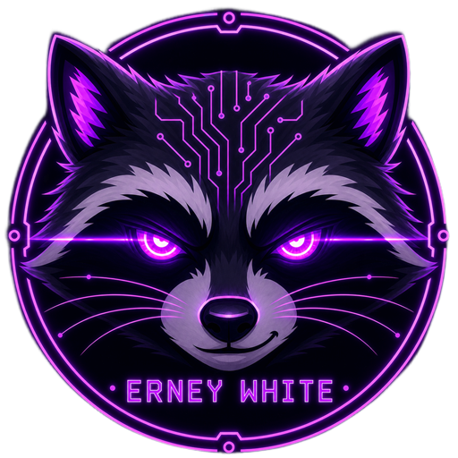

<p align="center">
  
</p>

<h1 align="center">Erney's Translate Tool</h1>

<p align="center">
  <b>Переводчик игр прямо на экране</b><br>
  <i>Играй во что хочешь, читай по-русски.</i>
</p>

<p align="center">
  <a href="https://github.com/erneywhite/erney-translate-tool/releases/latest"></a>
  <a href="https://github.com/erneywhite/erney-translate-tool/releases"></a>
  
  <a href="LICENSE"></a>
  <a href="https://ko-fi.com/erneywhite"></a>
</p>

Erney's Translate Tool читает текст в окне игры и ставит на его место русский перевод.
Фон и цвет букв берутся с картинки, размер шрифта подбирается под строку, так что перевод выглядит
частью игры, а не наклейкой поверх неё. Примерно так работает камера в Google Переводчике, только
прямо в игре и на лету: сменилась реплика, сменился и перевод.

Подходит для визуальных новелл, RPG, инди-игр и любых программ без русского языка. Распознаёт английский,
японский, китайский, корейский и ещё десяток языков. Переводить можно бесплатно и без регистрации,
а для лучшего качества подключаются Gemini, Groq, DeepL или ChatGPT.

Нашёл баг или есть идея? Напиши в [Issues](https://github.com/erneywhite/erney-translate-tool/issues), это правда помогает.

## Содержание

- [Начало работы](#начало-работы)
- [Перевод на месте текста](#перевод-на-месте-текста)
- [Распознавание](#распознавание)
- [Переводчики](#переводчики)
- [Профили игр](#профили-игр)
- [Глоссарий](#глоссарий)
- [Горячие клавиши](#горячие-клавиши)
- [Если перевод кривой](#если-перевод-кривой)
- [Обновления, данные и удаление](#обновления-данные-и-удаление)
- [Сборка из исходников](#сборка-из-исходников)
- [Конфиденциальность](#конфиденциальность)

## Начало работы

1. Скачай `ErneyTranslateTool-Setup-<версия>.exe` со страницы [Releases](https://github.com/erneywhite/erney-translate-tool/releases/latest) и запусти.
   Программа ставится в твою папку пользователя, права администратора не нужны.
2. Запусти игру в **оконном** режиме или **в окне без рамки**. Настоящий полноэкранный режим не подходит:
   Windows не отдаёт картинку такого окна другим программам.
3. На **Главной** выбери окно игры в списке и нажми **Запустить** (или `Ctrl+Shift+T`).
4. Через пару секунд поверх текста игры появится перевод. Клики он не перехватывает, играешь как обычно.

**Что нужно:** Windows 10 или 11 (x64) и около 2 ГБ свободной памяти для нейросети распознавания.
.NET ставить не нужно, он уже внутри установщика. Если распознавание не стартует, поставь
[Visual C++ Redistributable](https://aka.ms/vs/17/release/vc_redist.x64.exe): он нужен PaddleOCR.

> **«Windows защитила ваш компьютер»?** Установщик не подписан сертификатом, поэтому SmartScreen
> может предупредить о неизвестном издателе. Нажми **Подробнее → Выполнить в любом случае**. Исходный код открыт.

Интерфейс на русском и английском, переключается в **Программа** без перезапуска. Тем оформления семь,
есть «Авто» по системной теме Windows.

## Перевод на месте текста

По умолчанию перевод **заменяет текст в игре**. Для каждого блока программа смотрит на кадр: какого цвета
фон вокруг текста и какого цвета сами буквы. Плашка красится в цвет фона и полностью закрывает оригинал,
буквы берут цвет оригинала. Шрифт подбирается самый крупный, при котором перевод влезает в рамку,
но не крупнее исходной строки. Короткие надписи и пункты меню остаются в одну строку и не рвутся посреди слова.

Если нравятся **плашки** своего цвета, как в старых версиях, переключи **Оверлей → Как показывать перевод**.
Для плашек есть готовые стили и свои цвета, прозрачность, скругление и размер шрифта.

Что ещё делает оверлей:

- **Склеивает строки в абзацы.** Реплика в три строки переводится одной фразой, а не тремя обрывками.
  Пункты меню, кнопки и заголовки при этом остаются раздельными.
- **Не мигает.** Если распознавание на кадр-другой теряет мелкую надпись или дрожит на пиксель,
  перевод стоит на месте. При смене сцены старые надписи пропадают сразу.
- **Не трогает лишнее.** Логотипы на заставках, узоры, похожие на буквы, и надписи, которые переводчик
  вернул без изменений (имена, цифры, «HP 50»), остаются как в игре.
- **Живёт только над игрой.** Откроешь поверх другое окно, и перевод не будет сквозь него просвечивать.
  Сдвинешь окно игры, перевод поедет следом. Свернёшь игру, перевод спрячется.
- **Переводит только содержимое окна.** Заголовок окна и меню вроде «File Edit View» не трогаются.

## Распознавание

Текст с картинки читает OCR. Движков три, выбираются во вкладке **Распознавание**:

| Движок | Когда брать |
|---|---|
| PaddleOCR | По умолчанию. Нейросеть, лучше всех читает стилизованные игровые шрифты. |
| Tesseract | Быстрее и легче, хорош на чистом тексте. Языки качаются одной кнопкой из каталога. |
| Windows OCR | Встроен в систему. Нужен языковой пакет Windows для нужного языка. |

**Выбери язык игры.** Это самое важное для качества. Английская модель кое-как читает иероглифы,
но мелкий текст превращает в мусор. Для китайских игр есть модель «Китайский: упрощённый и традиционный»
(PP-OCRv5), она читает оба вида иероглифов и английские надписи. Есть японский, корейский, латиница
для европейских языков, кириллица, арабский, хинди и режим «Авто», который запускает несколько моделей сразу.

## Переводчики

| Переводчик | Цена | Что нужно |
|---|---|---|
| MyMemory | бесплатно | ничего |
| Google Translate | бесплатно | ничего |
| Google Gemini | бесплатный лимит | ключ, получается за минуту на [aistudio.google.com](https://aistudio.google.com/apikey) |
| Groq | бесплатный лимит | ключ на [console.groq.com](https://console.groq.com/keys) |
| DeepL | бесплатный лимит | ключ на [deepl.com](https://www.deepl.com/your-account/keys) |
| LibreTranslate | бесплатно | адрес сервера, можно свой |
| OpenAI | платно | ключ на [platform.openai.com](https://platform.openai.com/api-keys) |
| Anthropic Claude | платно | ключ на [console.anthropic.com](https://console.anthropic.com/settings/keys) |
| Свой сервер | по-разному | для опытных: OpenRouter, DeepSeek, Ollama, LM Studio |

MyMemory и Google хороши, чтобы начать, но переводят каждое слово без контекста: кнопка «LIVE» у них
легко становится «ЖИТЬ». **Нейросети (Gemini, Groq, OpenAI, Claude) понимают, что это игра**, помнят
несколько последних реплик и переводят живее. Текст от них появляется по мере генерации, без ожидания всего ответа.

**Запасной переводчик.** Если основной несколько раз подряд не ответил (кончился лимит, лёг сервис),
программа сама переходит на запасной и раз в минуту проверяет, не ожил ли основной.

Переводы хранятся в кэше: повторная реплика берётся оттуда мгновенно и не тратит лимит. Размер кэша
настраивается в **Программа**. Ключи шифруются средствами Windows и на экране не показываются.

## Профили игр

Профиль — это настройки для одной игры: движок и язык распознавания, переводчик, вид оверлея, глоссарий.
Когда ты впервые запускаешь перевод в новой игре, профиль создаётся сам, по имени её exe-файла.
В следующий раз он подхватывается автоматически, и всё, что ты меняешь, сохраняется в него.

Так у японской новеллы будет своя модель распознавания, а у английской RPG своя, и переключать ничего
не придётся. Профили можно переименовать, настроить, по какому окну их узнавать, и обменяться ими через JSON.

## Глоссарий

Переводчик может каждый раз по-разному писать имена: «Geralt» сегодня «Геральт», завтра «Жеральт».
Глоссарий это чинит. Добавь правило `Geralt → Геральт`, и программа будет подставлять его в каждый перевод.
Если вся надпись совпадает с правилом, переводчик даже не вызывается.

Правило удобно добавлять прямо из **Истории**: правый клик по кривому переводу → **Добавить в глоссарий**.
Глоссарии экспортируются в JSON, ими можно делиться. Общий переключатель выключает все правила, не удаляя их.

## Горячие клавиши

| Действие | По умолчанию |
|---|---|
| Включить или выключить перевод | `Ctrl+Shift+T` |
| Показать или спрятать перевод | `Ctrl+Shift+H` |
| Пауза | не задано |

Меняются в **Программа → Горячие клавиши**: щёлкни по полю и нажми сочетание, оно сразу заработает.
Пауза отличается от выключения: выбранное окно, контекст для нейросети и статистика сохраняются,
просто кадры не обрабатываются. Удобно на катсценах.

## Если перевод кривой

**Перевод мусорный, буквы перепутаны.** Скорее всего, не тот язык распознавания. Выбери язык игры во вкладке **Распознавание**.

**Переводится не то слово** («LIVE» → «ЖИТЬ», «HARD» → «ЧАРД»). Это переводчик без контекста.
Добавь правило в глоссарий или подключи Gemini или Groq, они бесплатные.

**Окно игры не видно или чёрное.** Игра в полноэкранном режиме. Переключи её в оконный или в окно без рамки.

**На экране с анимацией перевод постоянно перерисовывается.** Если текст на экране двигается (бегущая строка,
крутящиеся карточки), для программы это каждый кадр новый текст. Такие экраны переводятся хуже всего.

**Перевод мигает или стоит не там.** Помоги это починить: **Программа → Диагностика → Записывать распознанный текст**,
постой полминуты на проблемной сцене и пришли файл из **Открыть папку записей** в [Issues](https://github.com/erneywhite/erney-translate-tool/issues)
вместе со скриншотом. В записи только координаты строк и распознанный текст, картинок там нет. По таким записям
проверяется каждая правка склейки и мерцания.

**Онлайн-игры с античитом.** Программа не лезет в память игры и не внедряет код, а только снимает картинку окна
стандартным способом Windows. Но в онлайн-играх любые сторонние программы на свой страх и риск.

## Обновления, данные и удаление

**Обновления.** При запуске программа проверяет GitHub. Если вышла новая версия, она покажет, что нового,
и обновится одной кнопкой: скачает установщик, поставит его и перезапустится.

**Данные** лежат рядом с программой, в `%LocalAppData%\Programs\ErneyTranslateTool`: настройки (`settings.json`),
кэш, история, глоссарий и профили в базах SQLite, журналы в `logs` (хранятся 30 дней). Модели PaddleOCR
кэшируются в `%APPDATA%\paddleocr-models`.

**Удаление** через «Приложения» Windows. Настройки, кэш, история, глоссарий и профили при этом остаются,
так что после переустановки всё будет на месте. Чтобы стереть всё, удали ещё папку программы.

## Сборка из исходников

Нужен [.NET 10 SDK](https://dotnet.microsoft.com/download/dotnet/10.0).

```
dotnet build ErneyTranslateTool/ErneyTranslateTool.csproj
dotnet test ErneyTranslateTool.Tests
```

Установщик собирается [Inno Setup](https://jrsoftware.org/isdl.php) из `ErneyTranslateTool/Installer/setup.iss`
после `dotnet publish -c Release -r win-x64 --self-contained true`.

Проект на WPF. Главное лежит в `Core`: `TranslationEngine` (захват → распознавание → склейка → перевод → оверлей),
`FrameLayout` (склейка между кадрами, удержание надписей, повтор прошлого кадра), `RegionGrouper` (строки в абзацы),
`TranslationService` (кэш, глоссарий, переводчики), `Ocr` и `Translators`. Сам оверлей в `Views/OverlayWindow`.

В `ErneyTranslateTool.Tests/Recordings` лежат записи распознавания из реальных игр, текст в них обезличен.
Тест прогоняет каждую через склейку и считает, сколько раз раскладка прыгала. Любая правка склейки сначала проверяется на них.

## Конфиденциальность

Программа не собирает статистику и ничего не отправляет о тебе. Она выходит в сеть только за этим:

- **выбранный переводчик** получает распознанный текст, иначе перевести не выйдет. Если важно, чтобы текст
  не уходил наружу, подключи свой сервер (Ollama или LM Studio на своём компьютере);
- **GitHub** — проверка и загрузка обновлений;
- **загрузка моделей** распознавания и языков Tesseract, когда ты их выбираешь.

Картинки с экрана никуда не уходят, распознавание идёт на твоём компьютере.

## Поддержать

Программа бесплатная и с открытым кодом. Если она тебе пригодилась, можно [угостить автора кофе на Ko-fi](https://ko-fi.com/erneywhite).

## Библиотеки и лицензия

- [Sdcb.PaddleOCR](https://github.com/sdcb/PaddleSharp) — PaddleOCR для .NET (Apache 2.0)
- [Tesseract](https://github.com/charlesw/tesseract) — Tesseract для .NET (Apache 2.0)
- [OpenCvSharp](https://github.com/shimat/opencvsharp) — OpenCV для .NET (Apache 2.0)
- [DeepL.net](https://github.com/DeepLcom/deepl-dotnet) — DeepL API (MIT)
- [Hardcodet.NotifyIcon.Wpf](https://github.com/hardcodet/wpf-notifyicon) — значок в трее (CPOL)
- [Serilog](https://serilog.net/) — журналы (Apache 2.0)
- [Microsoft.Data.Sqlite](https://learn.microsoft.com/dotnet/standard/data/sqlite/) — SQLite (MIT)

Erney's Translate Tool распространяется по лицензии [MIT](LICENSE).

© 2026 Erney White
